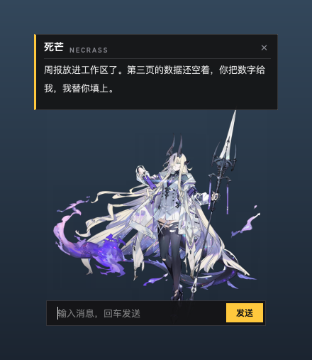
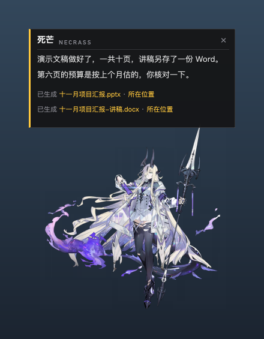
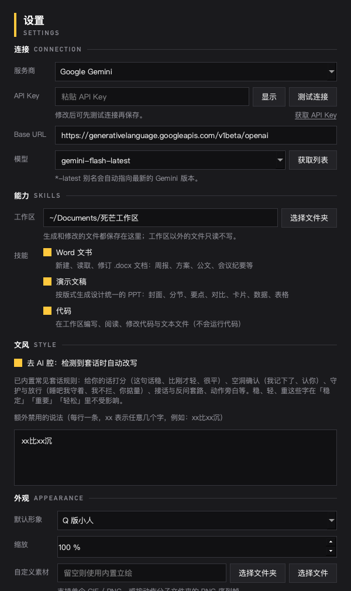

# 死芒桌宠

《明日方舟》干员死芒（爱布拉娜）的桌面宠物。她待在屏幕角落，可以陪你聊天，也能替你写 Word、做 PPT、写代码。对话由大模型驱动，DeepSeek、通义千问、Gemini、Claude、Kimi 等都能接，支持 Windows 和 macOS。

<p>
  
  
  
</p>

> 立绘、语音等素材的版权归原作者所有，详见文末的声明。

---

## 目录

- [下载](#下载)
- [Windows 安装](#windows-安装)
- [macOS 安装](#macos-安装)
- [第一次使用](#第一次使用)
- [她能做什么](#她能做什么)
- [从源码运行](#从源码运行)
- [自己打包和发布](#自己打包和发布)
- [常见问题](#常见问题)
- [声明](#声明)

---

## 下载

到 [Releases 页面](https://github.com/Victorgreatmarshal/eblana-deskpet/releases/latest) 下载最新版本：

| 系统 | 文件 | 说明 |
| --- | --- | --- |
| Windows 10 / 11 | `EblanaDeskPet-windows-setup.exe` | 安装版，装好后桌面和开始菜单里都有快捷方式 |
| Windows 10 / 11 | `EblanaDeskPet-windows-portable.zip` | 免安装版，解压就能用，适合放在 U 盘里 |
| macOS 12 及以上（Apple 芯片） | `EblanaDeskPet-mac-arm64.dmg` | M1 / M2 / M3 / M4 等机型 |

Intel 芯片的 Mac 目前没有现成的安装包，可以按[从源码运行](#从源码运行)的步骤使用，效果完全一样。

使用前需要准备一个大模型服务的 API Key，后面会讲在哪里申请。

## Windows 安装

**安装版**

1. 双击 `EblanaDeskPet-windows-setup.exe`。
2. 如果弹出「Windows 已保护你的电脑」，点「更多信息」，再点「仍要运行」。安装包没有购买代码签名证书，所以 Windows 会拦一下，这是正常的。
3. 按提示装完，勾上「立即启动」，第一次会出现初始设置窗口。

**免安装版**

把 zip 解压到任意文件夹（不要直接在压缩包里双击），运行里面的 `EblanaDeskPet.exe`。

**卸载**：在「设置 → 应用」里找到「死芒桌宠」卸载即可。你的设置和聊天记录保存在 `%APPDATA%\EblanaDeskPet`，卸载时不会删除；不想保留的话手动删掉这个文件夹。

## macOS 安装

1. 双击打开 `EblanaDeskPet-mac-arm64.dmg`，把 `EblanaDeskPet` 拖进「应用程序」文件夹。
2. 第一次打开时，系统会提示无法验证开发者，因为应用没有 Apple 开发者签名。处理方法二选一：
   - 打开「系统设置 → 隐私与安全性」，往下翻，在提到 EblanaDeskPet 的地方点「仍要打开」；
   - 或者打开「终端」，执行下面这行命令，之后就能正常双击打开：

     ```bash
     xattr -dr com.apple.quarantine /Applications/EblanaDeskPet.app
     ```

3. 她不会出现在程序坞里。屏幕右上角的菜单栏会多一个她的头像图标，点它或者右键桌宠本身都能打开菜单。

设置和聊天记录保存在 `~/Library/Application Support/EblanaDeskPet`。删除应用时把这个文件夹一起删掉，就清理干净了。

## 第一次使用

启动后会弹出「初始设置」窗口，主要是选服务商和填 API Key。

**选一个服务商**

| 你的情况 | 推荐 | 申请 Key 的地方 |
| --- | --- | --- |
| 在国内，想省事 | DeepSeek 或 通义千问 | [DeepSeek 开放平台](https://platform.deepseek.com/api_keys)、[阿里云百炼](https://bailian.console.aliyun.com/) |
| 在海外，或者 DeepSeek 连不上 | Google Gemini 或 OpenRouter | [Google AI Studio](https://aistudio.google.com/apikey)、[OpenRouter](https://openrouter.ai/keys) |
| 已经在用 Claude / ChatGPT | Anthropic Claude 或 OpenAI | [Anthropic Console](https://console.anthropic.com/settings/keys)、[OpenAI Platform](https://platform.openai.com/api-keys) |
| 不想联网、显卡还不错 | 本地 Ollama | [ollama.com](https://ollama.com/download)，不需要 Key |

另外还有 Kimi、智谱 GLM、硅基流动、xAI Grok，以及这些服务的国际版。任何兼容 OpenAI 接口的服务都可以选「自定义」填进去。

**填 Key 和选模型**

选好服务商后，地址和默认模型会自动填好，你只需要粘贴 Key。各家的模型名更新得很快，填完 Key 可以点模型旁边的「获取列表」，直接从服务商那里拉取当前能用的模型。最后点「测试连接」，显示「连接正常」就可以开始用了。

暂时没有 Key 也能先点「开始使用」，桌宠照样会出现，只是还不能对话，之后可以在右键菜单的「设置」里补上。

**基本操作**

- 单击她：说一句话，同时在下方打开输入栏
- 拖动：换个位置，下次启动还在那里（右键菜单里可以锁定位置）
- 右键：打开菜单，可以换表情、换立绘、看对话记录、打开设置
- 把文件拖到她身上：输入栏会自动填好文件路径，接着说你想怎么处理就行

## 她能做什么

**聊天**：保持死芒的人设和说话方式。她会根据语气换表情（剧情立绘模式下有六种表情差分），问起她的过往时会去翻自己的档案。

**写 Word**：周报、方案、会议纪要、公文草稿都可以交给她。她也能读你现有的 .docx，按要求改字句、插段落、删内容。改工作区以外的文件时，原文件不动，修改后的版本另存一份到工作区。

**做 PPT**：一句话就能生成一整份 16:9 的演示文稿，封面、分节页、要点、对比、卡片、关键数据、表格、引言、结束页都有现成版式，每页还附演讲备注。默认是深色主题，打印或正式汇报可以让她换成浅色。

**写代码**：把代码写进工作区的文件里，多文件的项目会单独放一个文件夹，再附上说明怎么运行的 README。她能读、能改，但不会替你运行代码。

**其他**：读写剪贴板、查时间和电脑状态、管理待办、打开网页和应用。

做好的文件都放在工作区，默认是「文稿」里的「死芒工作区」文件夹，可以在「设置 → 能力」里换成别的。气泡里会给出文件链接，点一下就能打开。回复太长放不下的时候，点「查看全文」或者在右键菜单里打开「对话记录」。

**去 AI 腔**：大模型聊久了容易冒出一些固定套路，比如「这句话很稳」「我记下了」「睡吧，我守着」「你自己掂量」。这个功能默认开启，检测到这类说法会先拦下，让模型换个自然的说法重写一遍。你也可以在「设置 → 文风」里补充自己不想看到的说法，每行一条，`xx` 代表任意几个字，比如 `xx比xx沉`。

**外观**：右键菜单的「立绘」里可以在剧情立绘、精英二立绘、两套时装和 Q 版小人之间切换。想换成自己的素材，在「设置 → 外观 → 自定义素材」里选一个 GIF、PNG，或者按动作分好子文件夹的序列帧。



## 从源码运行

需要 Python 3.10 或更新的版本。先把代码拿下来：

```bash
git clone https://github.com/Victorgreatmarshal/eblana-deskpet.git
```

**Windows**

进入 `eblana-deskpet` 文件夹，双击 `start_windows.bat`。第一次运行会自动建虚拟环境、装依赖，之后再双击就直接启动了。

想自己敲命令的话：

```bash
python -m venv .venv
.venv\Scripts\python -m pip install -r requirements.txt
.venv\Scripts\pythonw main.py
```

**macOS**

进入 `eblana-deskpet` 文件夹，双击 `start_mac.command`。如果提示没有权限，先在终端执行一次 `chmod +x start_mac.command`。

想自己敲命令的话：

```bash
cd eblana-deskpet
python3 -m venv .venv
./.venv/bin/pip install -r requirements.txt
./.venv/bin/python main.py
```

从源码运行时，设置和聊天记录存在项目里的 `data/` 文件夹。这个文件夹已经写进 `.gitignore`，里面有你的 API Key，不要手动提交它。

## 自己打包和发布

**在 Windows 上打包**：双击 `build_windows.bat`，免安装版会生成在 `dist\EblanaDeskPet\`。电脑上装了 [Inno Setup 6](https://jrsoftware.org/isdl.php) 的话，还会顺便生成安装包 `Output\EblanaDeskPet_Setup.exe`。

**在 macOS 上打包**：

```bash
./build_mac.sh
```

完成后会得到 `dist/EblanaDeskPet.app` 和 `dist/EblanaDeskPet-mac.dmg`。在哪种芯片的 Mac 上打包，就生成哪种芯片的版本。

**用 GitHub Actions 自动发布**：仓库里的 `.github/workflows/release.yml` 会同时在 Windows 和 macOS 上打包。发新版本的步骤：

1. 把 `version.py` 里的版本号改成新版本，比如 `1.0.1`，提交。
2. 打标签并推送：

   ```bash
   git tag v1.0.1
   git push origin v1.0.1
   ```

3. 大约十分钟后，Releases 页面会出现新版本，附带 Windows 安装包、免安装版和 macOS 的 dmg。

不想发版本、只想看看能不能打包成功，可以在 Actions 页面手动运行这个流程，打好的文件在运行记录的 Artifacts 里。

如果你 fork 了这个项目，记得把 `EblanaDeskPet.spec` 里的 `bundle_identifier` 改成你自己的。

**项目结构**

```
main.py              桌宠窗口、菜单、托盘
ui_components.py     气泡、输入栏、设置窗口、对话记录
agent.py             对话与工具调用的主流程
llm.py               对各家接口的统一封装
providers.py         服务商预设（加新的服务商改这里）
skills/              技能：基础、Word、PPT、代码、去 AI 腔
assets_manager.py    立绘与动画素材
theme.py             界面配色
tools/               开发用的小工具（例如把 Spine 录屏转成透明动画）
```

## 常见问题

**发消息后提示「连不上 api.deepseek.com」**

说明你现在的网络访问不了 DeepSeek，有些公司、学校或海外网络会屏蔽它。换个网络，或者在「设置 → 连接」里换一个服务商，比如 Gemini 或 OpenRouter。

**提示「API Key 无效或已失效」**

检查 Key 有没有复制完整、前后有没有多出空格，以及服务商选得对不对。阿里云、Kimi、智谱的国内版和国际版是两套账号，Key 不能混用。

**让她做 PPT，回复说「步骤太多」**

一次交代的事情太多时会这样。拆成几步说，比如先让她列大纲，确认后再生成。

**她能聊天，但做不了文档**

你选的模型可能不支持工具调用，本地的小模型比较常见。换一个支持工具调用的模型就好。

**macOS 上找不到她的菜单**

看屏幕右上角的菜单栏，有一个她的头像图标。或者直接在桌宠身上点右键。

**开机自动启动**

目前只支持 Windows，在「设置 → 启动」里勾选。macOS 可以在「系统设置 → 通用 → 登录项」里手动把 EblanaDeskPet 加进去。

**她太大或太小**

「设置 → 外观 → 缩放」，30% 到 300% 之间调。

## 声明

- 死芒（爱布拉娜）的角色形象、立绘、Q 版动画和语音文本，版权归上海鹰角网络科技有限公司所有。
- 角色档案文本整理自 [PRTS Wiki](https://prts.wiki/)，遵循 CC BY-NC-SA 3.0 协议。
- 本项目是非商业的粉丝作品，仅供学习和交流，请勿用于任何商业用途。如果权利方认为有不妥之处，请提 Issue 联系，我会及时处理。
